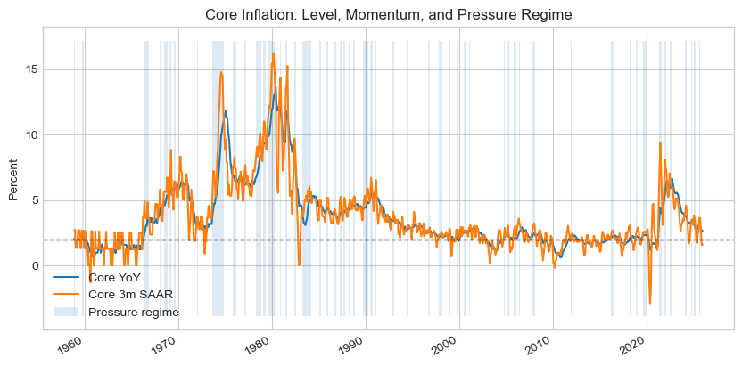
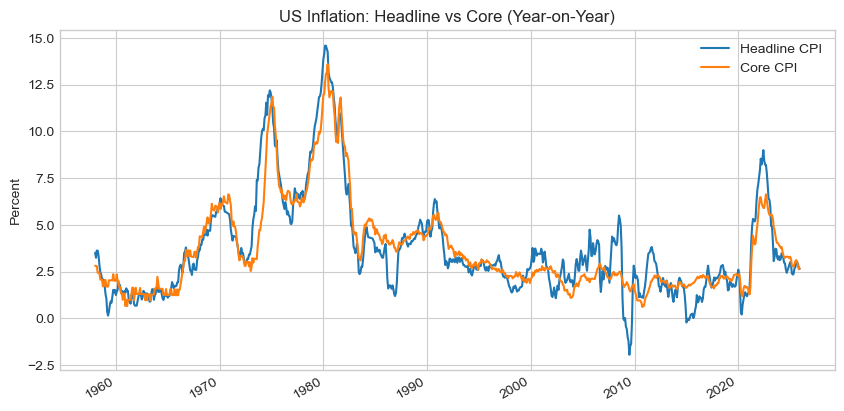
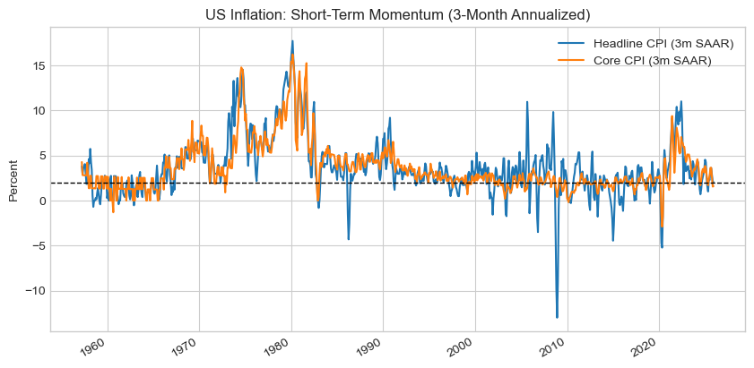

# US inflation pressure signals

Is underlying US inflation elevated, accelerating, or easing? This notebook rebuilds the kind of diagnostic that institutional macro teams run, from public data only: the level, short-term momentum and persistence of core inflation, combined into one rule-based regime call. The aim is diagnosis, not forecasting.



## What it computes

| Indicator | Definition | Why it is there |
|---|---|---|
| Level | Year-on-year change of headline and core CPI | The stable, medium-term reading |
| Momentum | 3-month annualised change (SAAR) | Reacts first at turning points |
| Persistence | Rolling 12-month lag-1 autocorrelation of core year-on-year inflation | Separates transitory moves from entrenched ones |

**Regime rule.** Pressure is *elevated* when core year-on-year inflation is above 2 percent, 3-month momentum runs above the year-on-year rate, and persistence is above 0.3. Otherwise the regime is *easing*. At the last run, with CPI through December 2025, the rule returned **EASING**.

<p align="center">
  
  
</p>

## What the charts say

- Headline is the noisy series and core carries the signal. Stretches where core stays high while headline falls line up with persistent services inflation.
- Momentum leads. Spikes in the 3-month rate precede sustained moves in the yearly rate, and recent momentum has moderated toward the 2 percent line.
- Persistence has come down from its 2021 to 2023 peak but still sits above its pre-pandemic range.

## Limitations, stated up front

- The thresholds (2 percent, momentum above level, persistence above 0.3) are judgement calls. They are not calibrated against later outcomes.
- Year-on-year inflation is smooth by construction, so its lag-1 autocorrelation is high most of the time. Read the persistence indicator against its own history, not as an absolute level.
- Only final-vintage CPI is used. A real-time version would use ALFRED vintages, since seasonally adjusted CPI is revised.
- One country. The ingestion cell is the only place that knows about FRED, so ECB or SNB series can be dropped in without touching the rest.

## Run it

The notebook needs a free FRED API key, read from an environment variable so that no key is ever committed.

```bash
pip install -r requirements.txt
export FRED_API_KEY=your_key_here   # free: https://fred.stlouisfed.org/docs/api/api_key.html
jupyter lab inflation_pressure_signals.ipynb
```

All outputs are stored in the notebook, so the analysis can be read on GitHub without running anything.

## Layout

| Path | Contents |
|---|---|
| `inflation_pressure_signals.ipynb` | Data pull, indicators, charts, regime rule, outputs included |
| `figures/` | Charts exported from the notebook |
| `requirements.txt` | pandas, numpy, matplotlib, fredapi, JupyterLab |

## Data

FRED series `CPIAUCSL` (CPI, all urban consumers, seasonally adjusted) and `CPILFESL` (CPI less food and energy), monthly from 1957.

## License

MIT. See [LICENSE](LICENSE).
